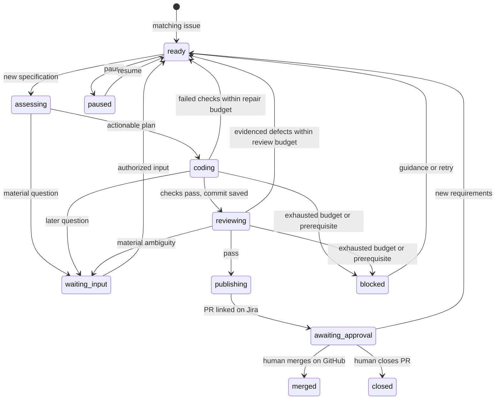

# Architecture

## Lifecycle

`awaiting_approval` is the persisted human-waiting state, not a Jira approval gate.
The code host exposes no merge method. Only a human approves/merges through GitHub.

New authorized input can supersede any active stage. SQLite retains canonical specifications
independently of model context. Tool boundaries check versions; publication also refreshes
Jira. One worker coordinates coding and a background poll/outbox thread accepts input.
There is no mandatory human plan-approval gate: actionable assessment proceeds to coding.

## Components

| Module | Responsibility |
|---|---|
| config | Local profile validation, literal environment loading |
| store | Versioned specifications, transactions, events, durable outbox |
| integrations | Jira/GitHub APIs, pagination, retries, write reconciliation |
| adapters | Explicit tracker, code-host and language contracts/registries |
| runtime | Host Git, container execution, Anthropic tool loop |
| context | Bounded message views and archived observation references |
| project | Go manifest/guides/skill discovery and external profile generation |
| coordinator | Assessment, coding, verification, review, PR handoff and status |
| cli | Foreground service, local checks, process lock |
| demo | Scripted actors driving the real coordinator with local Git |

## Authority and execution

The host holds credentials, talks to model/service APIs, and owns commits/pushes.
Tools execute in short-lived containers with no network, credentials, writable root,
or writable Git metadata. Assessment additionally mounts source read-only.
Coder/reviewer use separate checkouts; coder, assessor, verifier, and reviewer caches
are keyed by role, workspace, and image name. Image tags should be rebuilt/rotated deliberately.
Review experiments never become implementation.

Repository instructions are untrusted guidance, not permission to register host plugins,
bypass protected paths, or change authority. Jira account allowlists control comment input.
GitHub branch rules control human merging. Different sessions/models cannot prove unbiased review.

## Context and recovery

The first task message remains canonical; oversized tasks fail explicitly. Older verbose
tool results become observation references, then whole old exchanges can be removed from
the model view while preserving tool-call/result pairing. A session tool reads archived
bounded observations in chunks. Traces retain evidence, but are not resumable provider sessions.

SQLite state/message transactions and bot-owned comment markers support restart and lost-response
reconciliation. Incomplete assessment/coding/review/publication stages become runnable.
PR creation checks the known branch before creating another PR; an existing merged/closed PR
is authoritative. No merge write needs reconciliation because TicketForge never makes one.
Legacy persisted merging states recover to human waiting.

GET retries are bounded and cancellable during backoff. Model inference requests may retry
transient failures before tool execution and can incur duplicate inference charges.
Other writes are not blindly retried. Coordinator remote failures defer saved work and
eventually block after the retry budget; outbox delivery remains queued on failure.
No cross-service atomicity or distributed exactly-once guarantee is claimed.

See [current verification and limitations](release-readiness.md) and [extension contracts](extending.md).
