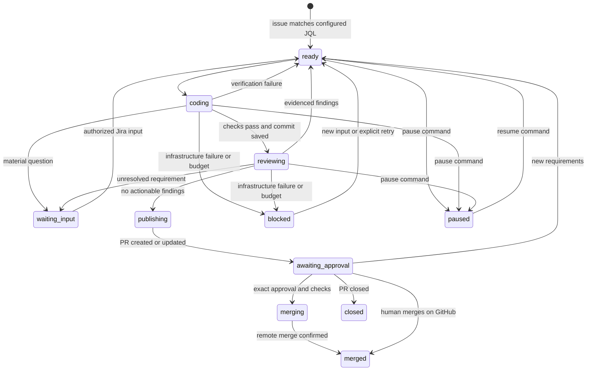

# Architecture

## State machine

New authorized input can invalidate any nonterminal stage. Every tool boundary checks the
persisted version. Before publication and merging, the coordinator also fetches Jira again.
Source comments, versioned specifications, and workflow transitions are stored independently
of model context. There is one worker and an independent Jira polling/outbox thread.

## Modules

| Module | Responsibility |
|---|---|
| `config.py` | Configuration validation and literal credential-file loading |
| `store.py` | SQLite state, version checks, audit events, durable comment outbox |
| `integrations.py` | Jira Cloud and GitHub APIs, pagination, reconciliation |
| `runtime.py` | Git workspaces, Docker command execution, model tool loop |
| `project.py` | Go discovery, bounded context, reusable repository profiles and images |
| `coordinator.py` | Agent sequencing, clarification, repairs, PR and merge policy |
| `cli.py` | Foreground service, local diagnosis, process lock and shutdown |
| `demo.py` | Scripted offline actors exercising the same coordinator |

## Authority boundaries

- The model proposes shell operations or a structured finish result.
- The sandbox executes only within a container and has no Jira/GitHub/model credentials.
- The coordinator exclusively owns host Git commits/pushes and service integrations.
- The reviewer can experiment in a fresh clone, but never mutate the coder's checkout.
- Jira account allowlists determine whose comments can instruct or approve.
- GitHub enforces remote branch rules and an exact-head SHA merge condition.

The target repository's instruction files are task guidance, not authority to bypass runtime
policy. Configured verification commands are operator-controlled. A reviewer verdict is
evidence, not merge permission. A human approval is an explicit action tied to current code.

## Recovery

SQLite transactions update task state and the corresponding outgoing message together where
required; the dispatcher reconciles bot-owned comment markers before delivery. A service
restart resets incomplete stages to runnable state and reconciles Jira before proceeding.
Existing ticket branches and PR heads are reused; GitHub PR creation reconciles by branch.
An uncertain merge remains in reconciliation rather than being treated as an implementation
failure. If GitHub already merged, that remote fact wins over newly arriving requirements.

Full cross-system exactly-once processing is not claimed. A single-process lock prevents
two local dispatchers from sending the same outbox entry concurrently. Non-idempotent remote
operations are reconciled through stable identifiers wherever the remote API permits.

## Extensions worth adding after the first real repository pilot

1. A representative ticket evaluation set for the first Go repository and its generated sandbox image.
2. Richer acceptance-criteria extraction with explicit provenance and test mapping.
3. Jira attachment/document retrieval with access checks if real tickets require it.
4. GitHub App authentication and separate merge identity for organization deployment.
5. Webhook ingestion and reconciliation polling if 15-second polling becomes insufficient.
6. A tested language-adapter interface for a second language, then Go workspace support.
7. Durable scheduling with per-ticket leases only when multiple workers are needed.

Do not add more agent roles or a vector database without an observed need.

## Primary references

- Jira enhanced JQL search: https://developer.atlassian.com/cloud/jira/platform/rest/v3/api-group-issue-search/
- Jira comments: https://developer.atlassian.com/cloud/jira/platform/rest/v3/api-group-issue-comments/
- GitHub pull requests and merge SHA: https://docs.github.com/en/rest/pulls/pulls
- GitHub branch rules: https://docs.github.com/en/repositories/configuring-branches-and-merges-in-your-repository/managing-protected-branches/about-protected-branches
- Anthropic tool results: https://platform.claude.com/docs/en/agents-and-tools/tool-use/handle-tool-calls
- Agent Skills: https://www.anthropic.com/engineering/equipping-agents-for-the-real-world-with-agent-skills
