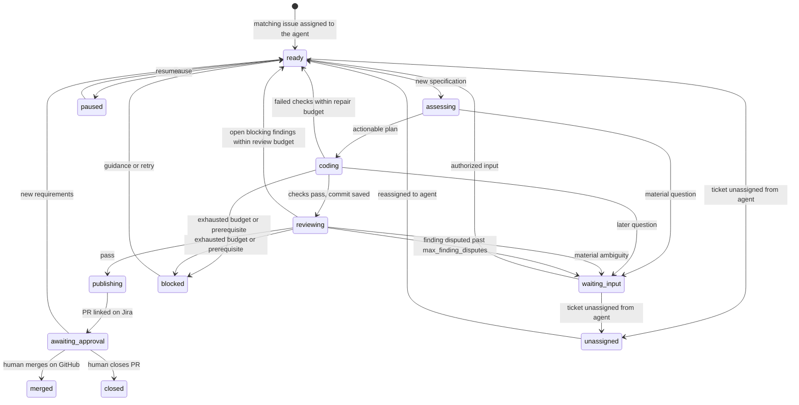

# Architecture

## Lifecycle

## Scheduling

One worker, non-preemptive. `tick()` first checks PRs waiting for review (each on its own
`status_poll_seconds` schedule), then runs one round of work. The ticket it works on is the
saved current ticket (`meta.current`) while it is `ready`; otherwise the ready ticket with the
oldest `ready_since` (ties by key). A SQLite trigger sets `ready_since` whenever a ticket enters
`ready`, so a ticket returning from `waiting_input` joins the back of the queue. A ticket
backing off (`retry_at` in the future) is skipped. Polling reads tickets the filter finds plus
tickets still in progress; `merged`, `closed` and `unassigned` tickets are not read again.

Requirement changes (comments, summary, description, or `jira_spec_fields`) bump the version
from any active state, including `awaiting_approval`; new work is pushed onto the same PR. The
coordinator records the spec each coding and review round used (`worked_specification`,
`reviewed_specification`) and gives agents the older one as `previous_specification`, so they
can drop obsolete work and withdraw findings that no longer apply.

An unassigned ticket with an open PR is still observed (`observe_pr`): merge or close is
recorded, nothing else. Its check failures are saved with `Store.note_watch_failure`, which
checks the version but never changes the state, so the back-off can never re-enable coding.
Back-off (`retry_at`) applies to PR checks as well as coding work. Approved lessons are
saved by a retryable, repeat-safe job (`try_save_lessons`) that backs off after failures.

Unassigning stops any agent state (`ready` through `blocked`) and bumps the version so an
in-flight model run is discarded. An open PR (`awaiting_approval`) keeps being tracked.

## Agent memory

| Input | Coder | Reviewer | Source |
|---|---|---|---|
| `project_context.repo_map` | yes | yes | `go list` per base commit, saved in `state/repo-maps/<sha>.json` (failures saved too) |
| `your_notes_from_last_round` | yes | no | coder `finish.notes`, kept in `data.coder_notes` |
| `history` | yes | no | `Repository.history`: base log, ticket commits, diffstat, status |
| learned section of the profile guide | yes | no | `/forge learn` approvals, appended on merge (`record_merge`) |
| build cache | per role | per role | shared across tickets of the repository |

The reviewer receives nothing written by the coder model: no notes, summary, reasoning or
lessons (`Repository.context(reviewer=True)` drops the learned section). Prior findings
and the coder's per-finding evidence arrive only in the reconciliation pass.

## Coder/reviewer dialogue

Findings live in a ledger in ticket data (`review.py`), with stable IDs that survive new
specification versions. Each finding is `open`, `resolved`, `withdrawn`, `advisory`, or
`escalated`.

| Step | Who | Sees | Must return |
|---|---|---|---|
| Fix | coder | spec, open findings + reviewer's latest reasoning, failed checks | one `fixed`/`disputed` response per open ID |
| Independent review | reviewer | spec, base/head SHAs | new findings, no resolutions |
| Reconcile (same session) | reviewer | prior open findings + coder's per-finding evidence | one resolution per prior ID |
| Decide | coordinator | ledger | publish, return to coder, or escalate to Jira |

The second reviewer pass is a `finish` hook: the coordinator answers the first `finish` call
with the prior findings (open blocking ones and advisory notes) as the tool result, so the
reviewer's first look is provably independent. The reply is also pinned to the task message,
so history compaction cannot drop it. First-pass findings are numbered `N1…` and kept unless
listed in `dropped` with evidence; the coordinator merges them with second-pass findings and
checks the reviewer's verdict against the combined result (`review.check_verdict`). A reviewer `open` after a coder `disputed` counts as one dispute; at
`max_finding_disputes` (default 1, so the first disagreement) the finding is escalated with both sides' evidence on Jira. Human input
creates a new version, which reopens escalated findings with fresh dispute counts.

Providers are configuration (`config.provider_specs`): a name maps to a wire protocol, base
URL, key variable and auth style. `models.py` has one session class per protocol behind the
same `step`/`respond` interface: Anthropic Messages, OpenAI Responses with `store: false`
(reasoning and call items replayed unchanged), and OpenAI-compatible Chat Completions.
OpenAI-style transcripts compact by dropping whole turns so calls and results stay paired.

`awaiting_approval` is the persisted human-waiting state, not a Jira approval gate.
The code host exposes no merge method. Only a human approves/merges through GitHub.

New authorized input can supersede any active stage. SQLite retains canonical specifications
independently of model context. Tool boundaries check versions; publication also refreshes
Jira. One worker coordinates coding and a background poll/outbox thread accepts input.
There is no mandatory human plan-approval gate: actionable assessment proceeds to coding.

## Components

| Module | Responsibility |
|---|---|
| config | Local profile validation, literal environment loading |
| store | Versioned specifications, transactions, events, durable outbox |
| integrations | Jira/GitHub APIs, pagination, retries, write reconciliation |
| adapters | Explicit tracker, code-host and language contracts/registries |
| runtime | Host Git, container execution, provider-neutral agent tool loop |
| models | Tool-calling sessions per wire protocol behind one interface |
| review | Finish schemas, validation, finding ledger, dispute/escalation rules |
| context | Bounded message/turn views and archived observation references |
| project | Go manifest/guides/skill discovery and external profile generation |
| coordinator | Assessment, coding, verification, review, PR handoff and status |
| cli | Foreground service, local checks, process lock |
| demo | Scripted actors driving the real coordinator with local Git |

## Authority and execution

The host holds credentials, talks to model/service APIs, and owns commits/pushes.
Tools execute in short-lived containers with no network, credentials, writable root,
or writable Git metadata. Assessment additionally mounts source read-only.
Coder/reviewer use separate checkouts. Coder, assessor, and verifier caches are keyed by
role, workspace, and image name. Managed reviewer rounds reuse a ticket/role/image cache
across fresh checkouts. Different tickets and roles remain isolated; unmanaged checkouts
fall back to a path-specific key. Image tags should be rebuilt/rotated deliberately.
Review experiments never become implementation.

Repository instructions are untrusted guidance, not permission to register host plugins,
bypass protected paths, or change authority. Jira account allowlists control comment input.
GitHub branch rules control human merging. Different sessions/models cannot prove unbiased review.

## Context and recovery

The first task message remains canonical; oversized tasks fail explicitly. Older verbose
tool results become observation references, then whole old exchanges can be removed from
the model view while preserving tool-call/result pairing. A session tool reads archived
bounded observations in chunks. Traces retain evidence, but are not resumable provider sessions.

SQLite state/message transactions and bot-owned comment markers support restart and lost-response
reconciliation. Incomplete assessment/coding/review/publication stages become runnable.
PR creation checks the known branch before creating another PR; an existing merged/closed PR
is authoritative. No merge write needs reconciliation because TicketForge never makes one.
Legacy persisted merging states recover to human waiting.

GET retries are bounded and cancellable during backoff. Model inference requests may retry
transient failures before tool execution and can incur duplicate inference charges.
Other writes are not blindly retried. Coordinator remote failures defer saved work and
eventually block after the retry budget; outbox delivery remains queued on failure.
The counter tracks consecutive failures and resets after successful work or a PR poll,
including observing a human merge. A reset cannot overwrite a newer specification.
GitHub secondary rate limits are identified from Retry-After or bounded error-message parsing;
permission-denied 403 responses stay ordinary errors. Consecutive rate limits increase waits.
No cross-service atomicity or distributed exactly-once guarantee is claimed.

See [current verification and limitations](release-readiness.md) and [extension contracts](extending.md).
